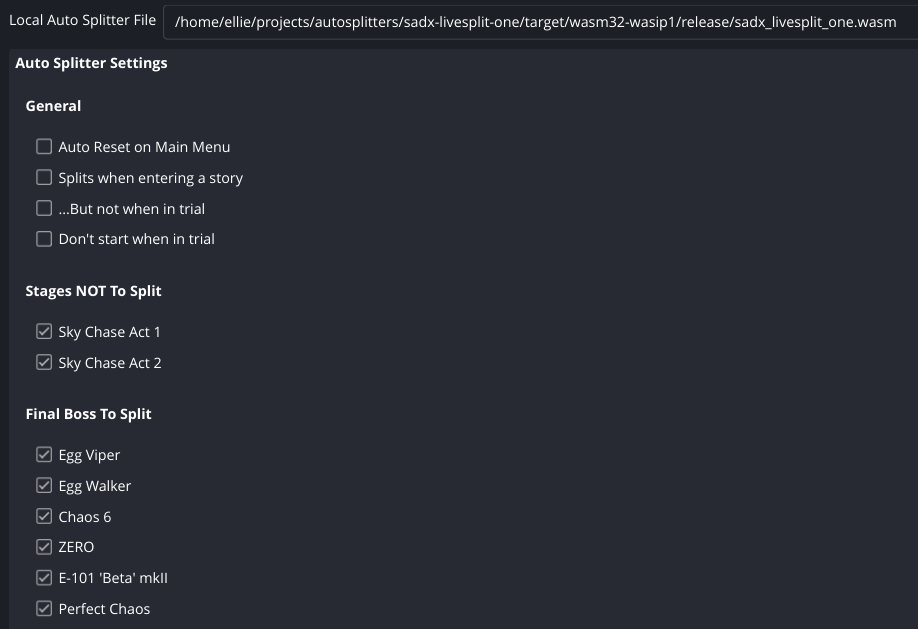

# sadx-livesplit-one



Version: `0.1.0`

LiveSplit One compatible alternative to Sora-yx's desktop LiveSplit ASL autosplitter from [`Sora-yx/autosplitters`](https://github.com/Sora-yx/autosplitters).

Credit to Sora-yx for the original Sonic Adventure DX ASL autosplitter logic this port is based on.

This port targets LiveSplit One's Auto Splitting Runtime (`asr`) instead of ASL. It preserves the current desktop script's core behavior:

- Auto start from the story select fade-to-black
- Optional auto reset on main menu
- Frame-counted in-game time and load removal
- Emblem, boss, stage-entry, boss-entry, upgrade, character-entry, and miscellaneous splits
- `sonic.exe` and `Sonic Adventure DX.exe` process names

## Install

Download `sadx_livesplit_one.wasm` from the release assets and add it as the autosplitter in LiveSplit One.

## Build

Requires the Rust `wasm32-wasip1` target:

```sh
rustup target add wasm32-wasip1
```

Build the release WebAssembly module with:

```sh
cargo build --release
```

The output is:

`target/wasm32-wasip1/release/sadx_livesplit_one.wasm`

## Release Checklist

- Run `cargo fmt --check`.
- Run `cargo check --release`.
- Run `cargo clippy --release -- -D warnings`.
- Run `cargo test --no-run`.
- Run `cargo build --release`.
- Attach `target/wasm32-wasip1/release/sadx_livesplit_one.wasm` to the GitHub release.
